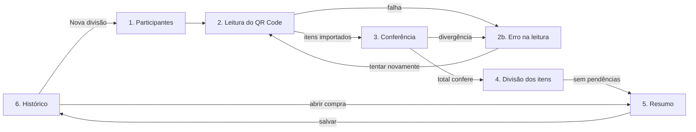

# Entrega 3 - SmartSplit
## Equipe e experiência do usuário

**Disciplina:** Empreendedorismo em Sistemas de Informação - UFLA, 2026/2  
**Professor:** Johnatan Oliveira  
**Responsável principal:** João Gabriel Salomão Baldim  
**Equipe:** Felipe Crisóstomo Silva Oliveira; João Carlos de Castro Ferreira; João Gabriel Salomão Baldim; Tobias Maugus Bueno Cougo.  
**Prazo:** 27/10/2026  
**Situação:** Versão padronizada para a Etapa 3.

[Índice da Etapa 3](README.md)

## 1. Objetivo e continuidade

Este documento reúne a parte de equipe e experiência do usuário da Etapa 3: o Personal Business Model Canvas dos integrantes, a descrição do produto, a jornada do usuário e os wireframes das telas principais. Ele parte de duas referências já consolidadas:

- o documento de [público, proposta de valor e validação](Publico_Proposta_Valor_Validacao.md), que define o organizador da compra como usuário prioritário, o receptor do resumo como usuário secundário e as tarefas T1 a T7 do teste;
- o [escopo e planejamento do MVP](Escopo_Planejamento_MVP.pdf), que define as funcionalidades F01 a F21, o fluxo principal e a referência visual das telas.

Nada aqui amplia o escopo do MVP. As telas e etapas da jornada correspondem às funcionalidades essenciais F01 a F10. As referências a funcionalidades adiáveis (F11 a F14) servem apenas para indicar onde elas entrariam, sem compromisso de implementação neste ciclo.

## 2. Parte C - Equipe: Personal Business Model Canvas

### 2.1. Como o canvas foi construído

O Personal Business Model Canvas adapta os nove blocos do Business Model Canvas a cada pessoa: quem ela é e o que tem, o que faz, a quem ajuda, como ajuda, como interage, por quais canais entrega, quem a apoia, o que lhe custa e o que ganha. No contexto da disciplina, o "cliente" de cada integrante é o projeto SmartSplit, a própria equipe e as pessoas envolvidas nos testes.

O preenchimento usa os papéis registrados na seção 12 da [Entrega 1](../entrega1/Entrega_1.md), as entrevistas realizadas por cada integrante na [Entrega 2](../entrega2/Entrega_2.md) e as responsabilidades da seção 5.1 do planejamento do MVP. Motivações e ganhos pessoais foram descritos de forma genérica e devem ser confirmados ou ajustados por cada integrante na revisão da equipe.

### 2.2. Canvas individuais

| Bloco | Felipe Crisóstomo Silva Oliveira | João Carlos de Castro Ferreira | João Gabriel Salomão Baldim | Tobias Maugus Bueno Cougo |
| --- | --- | --- | --- | --- |
| **Recursos-chave** (quem sou e o que tenho) | Comunicação com colegas e moradores; experiência na condução de entrevistas (P5 e P8 na Entrega 2). | Pesquisa documental e comparação de alternativas; atenção a valores e cálculos; entrevistas P6 e P7. | Organização e síntese de registros; escrita e padronização de documentos; entrevista P4. | Conhecimento técnico em desenvolvimento móvel (React Native, Expo, TypeScript); entrevistas P1, P2 e P3. |
| **Atividades-chave** (o que faço) | Elaborar o protocolo de validação, recrutar participantes, conduzir e consolidar as sessões. | Preparar casos de teste e gabaritos de divisão, conferir valores de forma independente, acompanhar riscos e custos. | Documentar a jornada e as telas, revisar a clareza da interface, organizar a documentação e o roteiro de demonstração. | Implementar importação da nota, regras de divisão, persistência e integração; corrigir defeitos. |
| **Clientes** (a quem ajudo) | Equipe, que precisa de evidências; participantes, que precisam de sessões claras e respeitosas. | Equipe, que precisa confiar nos valores calculados; avaliação do modelo de negócio. | Equipe, que precisa de documentação coerente; usuários, que precisam entender as telas sem ajuda. | Equipe, que precisa de um MVP executável; usuários do piloto. |
| **Proposta de valor** (como ajudo) | Transforma hipóteses em sessões de teste comparáveis e registros confiáveis. | Garante que cada parcela possa ser conferida contra um gabarito independente. | Traduz o escopo em fluxos e telas compreensíveis e mantém as entregas consistentes entre si. | Transforma o fluxo planejado em software funcional e verificável. |
| **Relacionamento** (como interajo) | Contato direto com participantes; repasse de achados à equipe após cada sessão. | Revisões cruzadas com Tobias sobre cálculos e com Felipe sobre os casos usados nos testes. | Revisões de texto e de tela com todos; alinhamento entre validação, escopo e interface. | Revisão de código e demonstrações periódicas do fluxo aos demais integrantes. |
| **Canais** (como entrego) | Roteiro, fichas e relatórios de sessão no repositório. | Tabelas de resultados esperados, registros de defeitos e revisão de viabilidade. | Documentos Markdown, wireframes e capturas legendadas no repositório. | Código versionado no GitHub e compilação Android para testes. |
| **Parceiros-chave** (quem me ajuda) | João Gabriel e João Carlos como observadores nas sessões; contatos estudantis para recrutamento. | Tobias, na regra de cálculo; Felipe, na seleção de notas e cenários. | Tobias, para a viabilidade das telas; Felipe, para os achados de usabilidade. | João Carlos, na conferência dos cálculos; João Gabriel, na revisão da interface. |
| **Custos** (o que dou) | Tempo de agendamento e condução de sessões fora do horário de aula. | Tempo de montagem e revisão de gabaritos; atenção a detalhes de centavos e descontos. | Tempo de revisão e retrabalho a cada mudança de escopo. | Maior carga técnica da equipe; risco de concentração do conhecimento do código. |
| **Receitas e benefícios** (o que ganho) | Prática em pesquisa com usuários e validação; nota na disciplina. | Prática em análise de custos, testes e modelo de negócio; nota na disciplina. | Prática em UX, documentação e comunicação de produto; nota na disciplina. | Experiência prática com aplicativo móvel real e portfólio; nota na disciplina. |

### 2.3. Leitura do conjunto

| Aspecto | Observação |
| --- | --- |
| Complementaridade | As quatro frentes cobrem o ciclo do MVP: construir (Tobias), conferir (João Carlos), testar (Felipe) e explicar (João Gabriel). |
| Dependência crítica | Concentração técnica em Tobias, já registrada como risco no planejamento do MVP. A resposta prevista é manter tarefas pequenas, instruções de execução e revisões do fluxo pelos demais. |
| Lacuna | A equipe não tem integrante dedicado a design visual. As telas seguem a referência de estilo do planejamento, e a clareza será avaliada nas sessões, sem presumir qualidade estética. |
| Ponto de atenção | Todos entrevistaram participantes da Entrega 2. Isso facilita o entendimento do problema, mas aumenta o risco de vieses; por isso o novo ciclo busca participantes fora do círculo imediato. |

## 3. Descrição do produto

### 3.1. Visão geral

| Item | Descrição |
| --- | --- |
| Nome | SmartSplit (provisório). |
| Categoria | Aplicativo móvel de divisão de compras de supermercado. |
| Para quem | Moradores de repúblicas e apartamentos compartilhados que organizam a divisão de uma compra conjunta de supermercado. |
| Problema | Repartir uma nota que mistura itens pessoais, coletivos e de parte do grupo exige conferir itens e calcular parcelas, tarefa considerada maçante por 7 dos 8 participantes da Entrega 2. |
| O que faz | Lê o QR Code da NFC-e, importa os itens, permite indicar quem consome cada um e calcula quanto cada pessoa deve a quem pagou. |
| Diferencial a testar | Menos digitação e um resumo conferível item a item, aproveitando os dados da nota digital. É hipótese, não resultado. |
| Plataforma do piloto | Android, com React Native e Expo; um organizador operando um aparelho. |
| Modelo de uso no piloto | Gratuito, sem login e com dados locais. Monetização permanece hipótese do modelo de negócio. |

### 3.2. Funcionalidades do MVP

| Área | Funcionalidades | O que o usuário consegue fazer |
| --- | --- | --- |
| Participantes | F01 | Cadastrar moradores por nome ou apelido e escolher quem participa da compra. |
| Leitura da nota | F02, F03, F10 | Apontar a câmera para o QR Code e importar descrição, quantidade e valor dos itens; receber aviso e tentar de novo quando algo falhar. |
| Conferência | F04 | Comparar itens e total com a nota em papel; ver sinalização de divergências ou importação incompleta. |
| Divisão | F05, F06 | Atribuir cada item a uma pessoa, a algumas ou a todas; desfazer escolhas; ver o que ainda está pendente. |
| Resumo | F07, F08 | Escolher quem pagou e ver a parcela de cada um, os itens que a compõem e quanto cada um deve reembolsar. |
| Histórico | F09 | Salvar a divisão e reabri-la depois, sem consultar a nota de novo. |

### 3.3. O que o produto não é

- Não controla todas as finanças da casa, aluguel ou contas recorrentes.
- Não processa pagamentos nem confirma Pix (F19, fora do escopo).
- Não interpreta fotografias de cupom por OCR ou IA nesta versão (F21).
- Não sincroniza dados entre aparelhos nem exige que todos os moradores instalem o aplicativo (F16, futura).
- Não promete compatibilidade com todas as notas de Minas Gerais ou do Brasil; apenas com os formatos verificados pela equipe.

### 3.4. Princípios de experiência

1. **Nunca concluir com dado errado em silêncio.** Falhas de leitura, importação incompleta e divergência de total são exibidas e impedem a finalização como divisão validada.
2. **Mostrar a origem de cada valor.** Toda parcela no resumo pode ser aberta para ver os itens e a fração atribuída à pessoa.
3. **Reduzir toques repetitivos.** Atalhos de "Todos" e seleção de várias pessoas por item, já que compras grandes são o caso de maior esforço.
4. **Não depender só de cor.** Cada participante tem cor e iniciais; o estado do item ("pendente", "atribuído") aparece em texto.
5. **Linguagem do morador.** Termos como "quem pagou", "deve para" e "dividir entre", sem jargão fiscal ou financeiro.

## 4. Jornada do usuário

### 4.1. Usuário de referência

A jornada principal representa o **organizador da compra**, perfil prioritário apoiado pelos relatos de P1, P2, P3, P4, P5, P6 e P8. Não se trata de uma persona com idade, renda ou história inventadas, mas da sequência de situações relatadas na Entrega 2 e do fluxo planejado para o MVP. Sentimentos indicados como hipótese ainda não foram medidos.

**Cenário:** um morador faz a compra semanal de supermercado para a casa, paga a nota inteira e, ao chegar, precisa acertar com outros três moradores. A compra tem itens só dele, itens de todos e itens que apenas parte do grupo consome.

### 4.2. Jornada atual, sem o produto

| Etapa | O que o organizador faz | Dor relatada ou hipótese | Base |
| --- | --- | --- | --- |
| 1. Compra | Paga a nota inteira no caixa. | Assume o adiantamento de todos. | Relato geral dos organizadores. |
| 2. Organização | Separa mentalmente ou no papel o que é de quem. | Tarefa maçante ou difícil de organizar. | P1-P6, P8. |
| 3. Cálculo | Soma itens na calculadora, divide os coletivos. | Esforço e possibilidade de erro de conta (erro não medido). | 6 de 8 usam calculadora. |
| 4. Registro | Anota valores em mensagens ou no papel. | Confusão nos registros. | P4 e P8 (WhatsApp). |
| 5. Comunicação | Envia a cada morador quanto deve. | Moradores podem questionar a origem do valor (hipótese). | Não medido. |
| 6. Acerto | Recebe reembolsos e confere quem pagou. | Controle informal. | Fora do escopo do MVP. |

### 4.3. Jornada com o SmartSplit

| Etapa | Ação do usuário | Tela / ponto de contato | Pensamento esperado (hipótese) | Oportunidade e cuidado de design | Tarefa de validação |
| --- | --- | --- | --- | --- | --- |
| 1. Gatilho | Chega em casa com a nota e decide acertar. | Ícone do app; nota em papel. | "Preciso dividir isso antes que eu esqueça." | Abrir direto em "Nova divisão". | — |
| 2. Participantes | Seleciona os moradores da compra ou cadastra um novo. | Tela 1 - Participantes. | "As mesmas pessoas de sempre." | Lembrar moradores já cadastrados; cadastro só com nome. | T1 |
| 3. Leitura | Aponta a câmera para o QR Code. | Tela 2 - Leitura da nota. | "Tomara que leia de primeira." | Moldura de enquadramento, lanterna e mensagem clara de falha. | T1 |
| 3a. Falha | Vê o aviso e tenta de novo ou usa outra nota. | Tela 2b - Erro na leitura. | "O que deu errado?" | Explicar a causa provável (câmera, conexão, nota incompatível) sem jargão. | T2 |
| 4. Conferência | Compara itens e total com o cupom. | Tela 3 - Conferência. | "Os valores batem com o papel?" | Total em destaque e alerta se a soma não fechar; não permitir seguir com divergência. | T2 |
| 5. Divisão | Toca em cada item e escolhe quem consome. | Tela 4 - Divisão dos itens. | "Isso é só meu; isso é de todo mundo." | Atalho "Todos", contador de pendentes, desfazer. | T3, T4 |
| 6. Resumo | Marca quem pagou e confere as parcelas. | Tela 5 - Resumo. | "Agora sei quanto cada um me deve." | Parcela por pessoa expansível com os itens; soma igual ao total. | T5 |
| 7. Comunicação | Mostra a tela aos moradores. | Tela 5 - Resumo. | "Dá para provar de onde veio o valor." | Resumo legível em outra mão; compartilhamento em texto fica para F11. | T6, T7 |
| 8. Consulta posterior | Reabre a divisão quando alguém pergunta. | Tela 6 - Histórico. | "Onde estava aquela compra?" | Lista por data, mercado e total. | T6 |

### 4.4. Jornada do receptor do resumo

O receptor não opera o aplicativo no piloto. Sua jornada é curta: recebe ou vê o resumo, localiza o próprio nome, abre os itens que compõem sua parcela, entende a quem deve pagar e faz o reembolso fora do aplicativo. O ponto crítico é a tarefa T7: explicar a própria parcela sem ajuda. A tela de resumo foi desenhada para isso, com nome em destaque, valor devido, destinatário do reembolso e a lista de itens com a fração de cada um.

### 4.5. Momentos críticos

| Momento | Por que importa | Resposta na interface |
| --- | --- | --- |
| Primeira leitura do QR Code | Uma falha logo no início pode fazer o organizador voltar à calculadora. | Mensagem com causa provável e botão "Tentar novamente". |
| Conferência do total | Divisão sobre dados errados compromete a confiança no produto. | Bloqueio quando o total importado não fecha com a soma dos itens. |
| Compras grandes | Atribuir item por item pode anular o ganho de tempo. | Atalho "Todos", seleção múltipla e itens pendentes no topo. |
| Explicação ao receptor | Sem entender a origem, o morador pode contestar o valor. | Detalhamento de itens por pessoa no resumo. |

## 5. Wireframes das telas principais

### 5.1. Fluxo entre telas



### 5.2. Convenções

Os wireframes são de baixa fidelidade e indicam conteúdo, hierarquia e ações, não cores ou tipografia finais. `[ Botão ]` indica ação; `( )` e `(x)` indicam seleção; `▸` indica item expansível; iniciais como `AN` representam o avatar colorido do participante. Os nomes e valores são **fictícios e ilustrativos**, montados para que as contas fechem: total de R$ 132,60, pago por Ana.

### 5.3. Tela 1 - Participantes (F01)

```
┌────────────────────────────────────┐
│ ←  Nova divisão           Passo 1/4│
├────────────────────────────────────┤
│ Quem participa desta compra?       │
│                                    │
│ ┌────────────────────────────────┐ │
│ │ (x) AN  Ana                    │ │
│ │ (x) BR  Bruno                  │ │
│ │ (x) CA  Carla                  │ │
│ │ (x) DA  Davi                   │ │
│ │ ( ) EL  Elisa                  │ │
│ └────────────────────────────────┘ │
│                                    │
│ [ + Adicionar morador ]            │
│                                    │
│ 4 pessoas selecionadas             │
│                                    │
│ [      Ler nota fiscal  →        ] │
└────────────────────────────────────┘
```

- Moradores já cadastrados ficam salvos para as próximas compras.
- O botão principal só fica ativo com pelo menos duas pessoas selecionadas.

### 5.4. Tela 2 - Leitura do QR Code (F02, F03)

```
┌────────────────────────────────────┐
│ ←  Ler nota fiscal        Passo 2/4│
├────────────────────────────────────┤
│                                    │
│     ┌──                    ──┐     │
│     │                        │     │
│          [ câmera ativa ]          │
│     │                        │     │
│     └──                    ──┘     │
│                                    │
│  Aponte para o QR Code no rodapé   │
│  do cupom fiscal (NFC-e).          │
│                                    │
│ [ Lanterna ]                       │
│                                    │
│ ⟳ Consultando a nota...            │
└────────────────────────────────────┘
```

- Na primeira utilização, o aplicativo explica por que precisa da câmera antes de pedir a permissão.
- Durante a consulta, o indicador de carregamento substitui a instrução.

### 5.5. Tela 2b - Erro na leitura (F10)

```
┌────────────────────────────────────┐
│ ←  Ler nota fiscal                 │
├────────────────────────────────────┤
│                                    │
│   ⚠  Não foi possível importar     │
│      esta nota                     │
│                                    │
│   Motivo provável:                 │
│   O portal da Sefaz não respondeu. │
│   Verifique sua conexão.           │
│                                    │
│   Nenhum valor foi salvo.          │
│                                    │
│ [        Tentar novamente        ] │
│ [         Ler outra nota         ] │
└────────────────────────────────────┘
```

- Outras mensagens previstas: câmera sem permissão, QR Code que não é de NFC-e, formato de nota não suportado e verificação manual exigida pelo portal.
- Nenhuma variação permite seguir para a divisão com dados incompletos.

### 5.6. Tela 3 - Conferência dos itens (F04)

```
┌────────────────────────────────────┐
│ ←  Conferir itens         Passo 3/4│
├────────────────────────────────────┤
│ Supermercado Exemplo · 26/10/2026  │
│ 7 itens                            │
│ ┌────────────────────────────────┐ │
│ │ Arroz 5 kg       1 un   28,00  │ │
│ │ Leite integral   6 un   33,00  │ │
│ │ Café 500 g       1 un   19,90  │ │
│ │   desconto             -1,90   │ │
│ │ Iogurte          4 un   13,00  │ │
│ │ Cerveja lata     6 un   27,00  │ │
│ │ Banana       1,250 kg    8,00  │ │
│ │ Detergente       2 un    5,60  │ │
│ └────────────────────────────────┘ │
│ Soma dos itens        R$ 132,60    │
│ Total da nota         R$ 132,60  ✓ │
│                                    │
│ Confira com o cupom em papel.      │
│ [      Valores conferem  →       ] │
│ [ Há diferença: ler novamente ]    │
└────────────────────────────────────┘
```

- Quando a soma dos itens não coincide com o total, o selo `✓` vira um alerta em texto e o botão principal fica desativado.
- Os dados fiscais não são editáveis nesta versão, conforme o escopo do MVP.

### 5.7. Tela 4 - Divisão dos itens (F05, F06)

```
┌────────────────────────────────────┐
│ ←  Dividir itens          Passo 4/4│
├────────────────────────────────────┤
│ 2 itens pendentes        [Desfazer]│
│ ┌────────────────────────────────┐ │
│ │ Iogurte · 13,00     PENDENTE   │ │
│ │ Cerveja lata · 27,00 PENDENTE  │ │
│ ├────────────────────────────────┤ │
│ │ Arroz 5 kg · 28,00    Todos    │ │
│ │ Leite · 33,00     AN BR CA     │ │
│ │ Café · 18,00          Todos    │ │
│ │ Banana · 8,00         AN       │ │
│ │ Detergente · 5,60     Todos    │ │
│ └────────────────────────────────┘ │
├────────────────────────────────────┤
│ Cerveja lata · 6 un · R$ 27,00     │
│ Quem consome?                      │
│ [Todos] [AN] [BR✓] [CA] [DA✓]      │
│ Dividir: (x) igual  ( ) por qtd.   │
│ BR 13,50 · DA 13,50                │
│ [            Aplicar             ] │
├────────────────────────────────────┤
│ [ Ver resumo ] (faltam 2 itens)    │
└────────────────────────────────────┘
```

- Os itens pendentes ficam no topo e o contador indica quantos faltam.
- O painel inferior abre ao tocar em um item e mostra a parcela calculada antes de aplicar.
- "Por quantidade" permite atribuir unidades diferentes a cada pessoa, preservando o valor total da linha.

### 5.8. Tela 5 - Resumo (F07, F08)

```
┌────────────────────────────────────┐
│ ←  Resumo da divisão               │
├────────────────────────────────────┤
│ Total da compra       R$ 132,60    │
│ Quem pagou?  [ AN Ana          ▾ ] │
├────────────────────────────────────┤
│ ▸ AN Ana       consumiu   31,90    │
│      pagou a compra · recebe 100,70│
│ ▾ BR Bruno     deve a Ana 37,40    │
│      Arroz 5 kg (1/4)       7,00   │
│      Leite (1/3)           11,00   │
│      Café (1/4)             4,50   │
│      Cerveja lata (1/2)    13,50   │
│      Detergente (1/4)       1,40   │
│ ▸ CA Carla     deve a Ana 36,90    │
│ ▸ DA Davi      deve a Ana 26,40    │
├────────────────────────────────────┤
│ Soma das parcelas R$ 132,60  ✓     │
│ [        Salvar divisão          ] │
└────────────────────────────────────┘
```

- Cada pessoa pode ser expandida para mostrar os itens e a fração atribuída, o que atende à tarefa T7.
- O pagador mostra o próprio consumo e o valor a receber, mas nunca aparece devendo a si mesmo.
- A conferência "Soma das parcelas" usa a regra de centavos definida no módulo de divisão.

### 5.9. Tela 6 - Histórico (F09)

```
┌────────────────────────────────────┐
│ SmartSplit                         │
├────────────────────────────────────┤
│ Divisões salvas                    │
│ ┌────────────────────────────────┐ │
│ │ 26/10 · Supermercado Exemplo   │ │
│ │ R$ 132,60 · 4 pessoas · Ana    │ │
│ ├────────────────────────────────┤ │
│ │ 19/10 · Supermercado Exemplo   │ │
│ │ R$ 98,15 · 3 pessoas · Bruno   │ │
│ └────────────────────────────────┘ │
│                                    │
│ Dados salvos só neste aparelho.    │
│                                    │
│ [        + Nova divisão          ] │
└────────────────────────────────────┘
```

- É a tela inicial depois da primeira divisão; abrir uma compra leva ao resumo salvo.
- O aviso de armazenamento local comunica o limite do piloto (sem backup ou sincronização).

### 5.10. Conferência dos valores ilustrativos

| Item | Valor | Dividido entre | Ana | Bruno | Carla | Davi |
| --- | ---: | --- | ---: | ---: | ---: | ---: |
| Arroz 5 kg | 28,00 | Todos | 7,00 | 7,00 | 7,00 | 7,00 |
| Leite integral (6 un) | 33,00 | Ana, Bruno, Carla | 11,00 | 11,00 | 11,00 | — |
| Café 500 g (com desconto) | 18,00 | Todos | 4,50 | 4,50 | 4,50 | 4,50 |
| Iogurte (4 un) | 13,00 | Carla | — | — | 13,00 | — |
| Cerveja lata (6 un) | 27,00 | Bruno, Davi | — | 13,50 | — | 13,50 |
| Banana (1,250 kg) | 8,00 | Ana | 8,00 | — | — | — |
| Detergente (2 un) | 5,60 | Todos | 1,40 | 1,40 | 1,40 | 1,40 |
| **Total** | **132,60** | | **31,90** | **37,40** | **36,90** | **26,40** |

Ana pagou R$ 132,60 e consumiu R$ 31,90; portanto recebe R$ 100,70, que corresponde à soma dos reembolsos de Bruno, Carla e Davi. Os valores foram escolhidos sem sobra de centavos para manter os wireframes legíveis; casos com sobra estão nos gabaritos de teste previstos no plano de validação.

### 5.11. Rastreabilidade

| Tela | Funcionalidades | Tarefas de validação | Etapa da jornada |
| --- | --- | --- | --- |
| 1. Participantes | F01 | T1 | 2 |
| 2. Leitura do QR Code | F02, F03 | T1 | 3 |
| 2b. Erro na leitura | F10 | T2 | 3a |
| 3. Conferência | F04 | T2 | 4 |
| 4. Divisão dos itens | F05, F06 | T3, T4 | 5 |
| 5. Resumo | F07, F08 | T5, T6, T7 | 6 e 7 |
| 6. Histórico | F09 | T6 | 8 |

## 6. Relação com as demais partes

O plano de validação usa estas telas como base das tarefas T1 a T7 e das observações de usabilidade registradas nas sessões. O planejamento do MVP permanece como referência das funcionalidades e da tecnologia; se a implementação exigir mudanças de tela, os wireframes serão atualizados e as diferenças registradas. As capturas reais do aplicativo, previstas para a Entrega 4, substituirão estes wireframes como evidência visual.

## 7. Referências e uso de IA

- *Tp_Empreendedorismo_2026_2.pdf*, seções 16 e 17, fornecido à equipe.
- *Entrega_1.md*, seção 12 (papéis iniciais), e *Entrega_2.md*, consolidada em 12/10/2026.
- *Publico_Proposta_Valor_Validacao.md* e *Escopo_Planejamento_MVP.pdf*, desta etapa.

O Claude (Anthropic) auxiliou na redação, na organização das tabelas e na elaboração dos wireframes em texto, a partir dos documentos da equipe. Não foram acrescentados participantes, respostas ou resultados de testes. Os nomes e valores dos wireframes são fictícios. As informações pessoais do Personal Business Model Canvas derivam dos papéis documentados e devem ser revisadas por cada integrante.
