# Entrega 4 — MVP funcional e validação da solução

**Equipe / empreendimento:** SmartSplit  
**Disciplina:** Empreendedorismo em Sistemas de Informação — UFLA, 2026/2  
**Data de referência:** 10/11/2026  
**Prazo:** 10/11/2026

**Integrantes:** Felipe Crisóstomo Silva Oliveira; João Carlos de Castro Ferreira; João Gabriel Salomão Baldim; Tobias Maugus Bueno Cougo.

**Repositório:** https://github.com/TobiasMaugus/Trabalho-Empreendedorismo

## 1. Objetivo da entrega

Apresentar o MVP funcional do SmartSplit e os resultados da primeira rodada de validação, conforme o protocolo definido na Entrega 3. A rodada verificou principalmente duas hipóteses:

- **H4:** importar e atribuir os itens da nota reduz o esforço e melhora a clareza da divisão.
- **H5:** uma proporção útil das NFC-e é importada corretamente.

Este documento descreve o fluxo implementado, organiza as evidências, compara os resultados com as metas da Entrega 3 e registra problemas, aprendizados e modificações. A consolidação foi feita a partir da versão revisada dos registros, publicada em 10/11/2026.

## 2. Organização das evidências

| Evidência | Arquivo | Conteúdo |
| --- | --- | --- |
| Registro das sessões | [`Registro_Sessoes_SmartSplit.xlsx`](Registro_Sessoes_SmartSplit.xlsx) | Recrutamento e agenda, sessões de organizadores e receptores, conferência das notas e resumo automático das métricas. |
| Gabaritos e resultados | [`Gabarito teste.pdf`](Gabarito%20teste.pdf) | Cenários de cálculo A, B e C, síntese das sessões, resultados frente às metas e conferência das notas. |
| Capturas do aplicativo | [`capturas/`](capturas/) | Telas do fluxo principal, geradas na versão web com dados de demonstração (seção 3). |
| Código do MVP | [`src/`](../../src/) | Projeto Expo/React Native utilizado nos testes. |
| Protocolo e metas | [Entrega 3](../entrega3/Publico_Proposta_Valor_Validacao.md) | Tarefas T1 a T7, métricas da seção 3.6 e critérios de decisão da seção 3.8. |

Na planilha e no PDF, os participantes são identificados apenas por código (V01 a V10). Não foram registrados CPF, chave de acesso da nota, endereço ou dados bancários. As notas são identificadas por código (N01 a N12) e estabelecimento.

## 3. Fluxo real do aplicativo

O fluxo abaixo descreve o comportamento do código disponível em `src/`, relacionado às tarefas do protocolo.

As capturas foram geradas em 10/11/2026 na versão web do aplicativo (`npm run web`), com três perfis fictícios e uma nota de demonstração de seis itens, no total de R$ 118,38. A leitura do QR Code e a consulta ao portal da SEFAZ dependem da câmera e do WebView do Android e não funcionam na versão web. Por isso, a nota de demonstração foi carregada pelo histórico, e as etapas de leitura e importação são descritas sem captura. As telas podem diferir em proporção das exibidas no celular, mas os componentes e textos são os mesmos.

### 3.1. Cadastro dos perfis (T1)

No primeiro uso, o aplicativo abre a tela **Crie seus Perfis**. O organizador informa de 2 a 11 moradores, escolhe uma cor para cada um e, opcionalmente, registra dados Pix. Os perfis ficam salvos no aparelho e podem ser alterados depois pela aba **Perfis**.

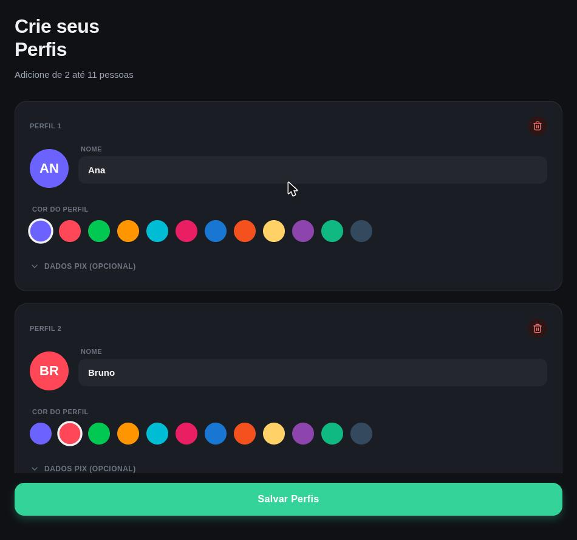

*Figura 1 — Cadastro de perfis.*

### 3.2. Leitura do QR Code e importação da nota (T1 e T2)

Na aba **Adicionar**, o botão **Ler Nota Fiscal** abre a câmera. Ao ler o QR Code da NFC-e, o aplicativo abre a página de consulta da SEF/MG em um WebView e extrai os seguintes dados:

- nome do estabelecimento, data e hora da compra;
- descrição, quantidade e valor de cada produto;
- valor total, valor pago e desconto.

Se o portal exibir uma verificação humana, o aplicativo aguarda que o usuário a conclua na própria página. Se nenhum produto for reconhecido ou ocorrer um erro de leitura, uma mensagem é exibida e a divisão não é iniciada.

Produtos vendidos por quilo ou litro são importados como uma unidade com o valor total da linha, identificados como **(Peso)**. A aba também oferece **Novo Gasto Manual**, recurso adicional fora do fluxo avaliado.

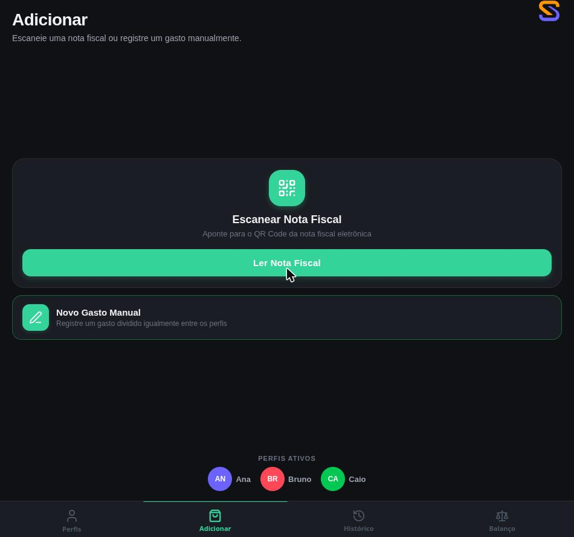

*Figura 2 — Aba Adicionar, com a leitura da nota e os perfis ativos.*

### 3.3. Conferência e atribuição dos itens (T2, T3 e T4)

Depois da importação, os produtos são apresentados **um de cada vez**. O topo da tela mostra o total da compra e o progresso, por exemplo "Item 1 de 6". Para cada produto, o organizador toca:

- no perfil de quem consumiu;
- em **Todos**, para dividir igualmente entre todos os perfis;
- no **Modo Personalizado**, para selecionar um subconjunto de pessoas.

Quando há mais de uma unidade, o campo **Unidades a atribuir** permite distribuir as unidades entre pessoas diferentes. Os botões **Desfazer** e **Reiniciar** corrigem atribuições. Se a nota tiver desconto, o valor aparece para ser distribuído entre os itens, sem ultrapassar o desconto registrado na nota.

| 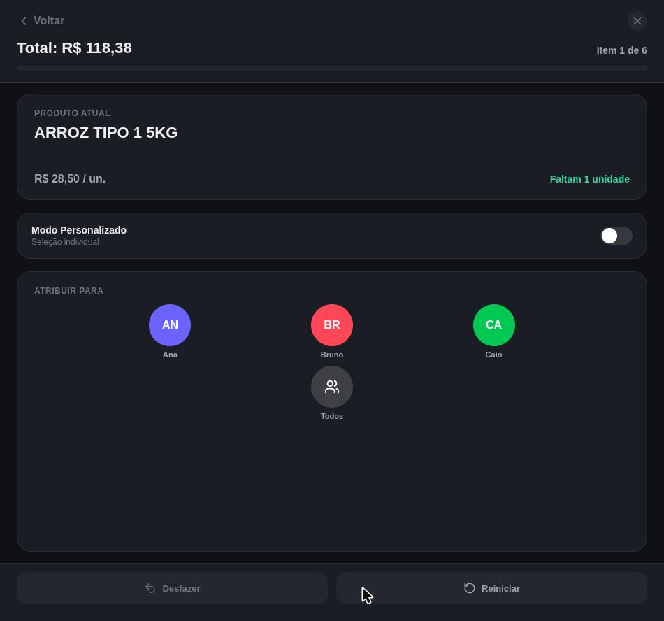 | 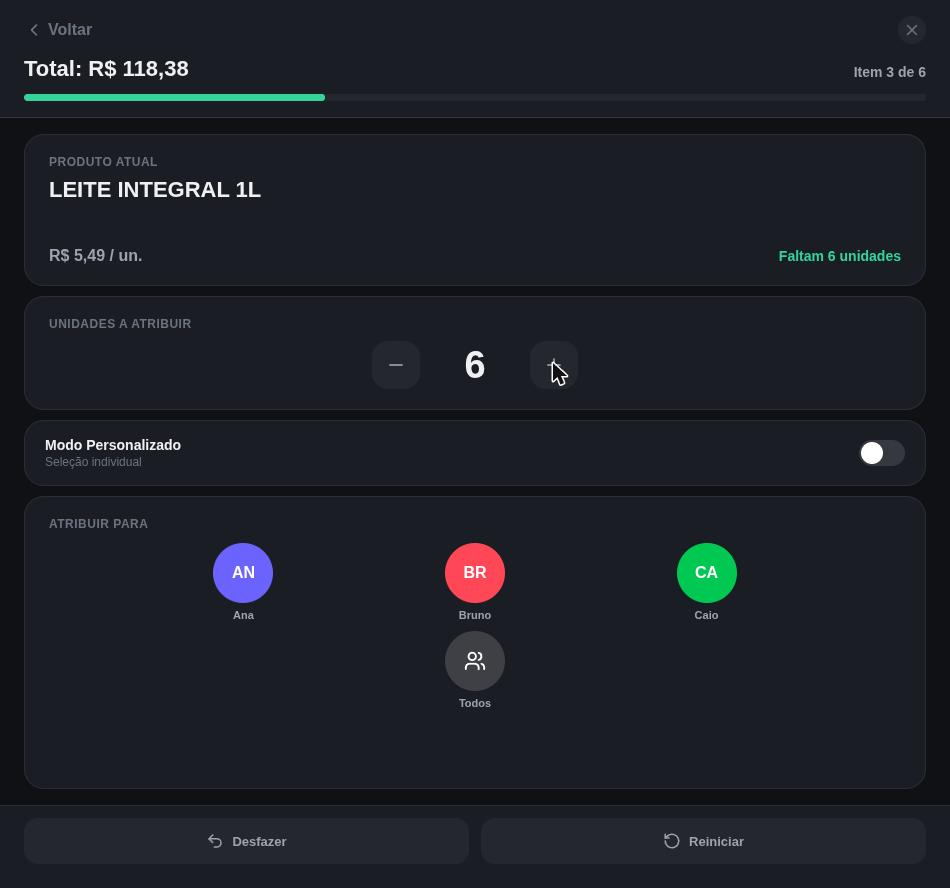 |
| --- | --- |
| *Figura 3 — Produto atual e atribuição.* | *Figura 4 — Produto com várias unidades.* |

| 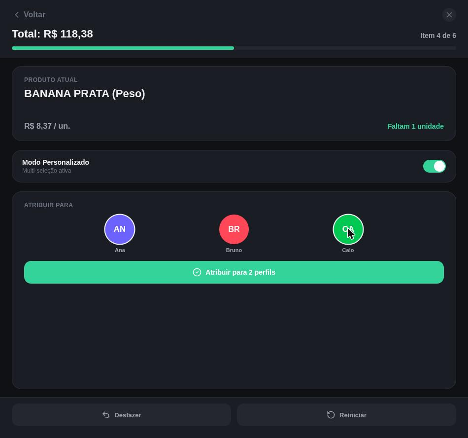 | 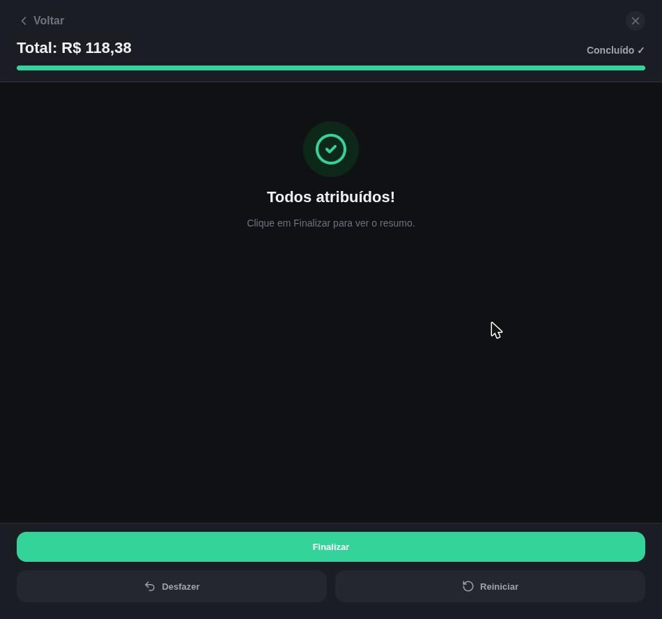 |
| --- | --- |
| *Figura 5 — Modo Personalizado: item dividido entre Ana e Caio.* | *Figura 6 — Todos os itens atribuídos.* |

Na demonstração, o arroz e o leite foram atribuídos a **Todos**. O feijão teve uma unidade atribuída a Ana e outra a Bruno. A banana, vendida por peso, foi dividida entre Ana e Caio. O iogurte foi atribuído a Bruno e o café a Caio. O botão **Finalizar** só aparece quando não há itens pendentes.

### 3.4. Pagador e resumo (T5)

A tela **Quem Pagou?** mostra o total da compra, a escolha do pagador, a parcela de cada pessoa e quanto cada uma deve ao pagador. Desse ponto é possível:

- **Salvar e Voltar**;
- **Compartilhar** um resumo em texto;
- **Gerar Pix**, se o pagador tiver chave cadastrada.

| 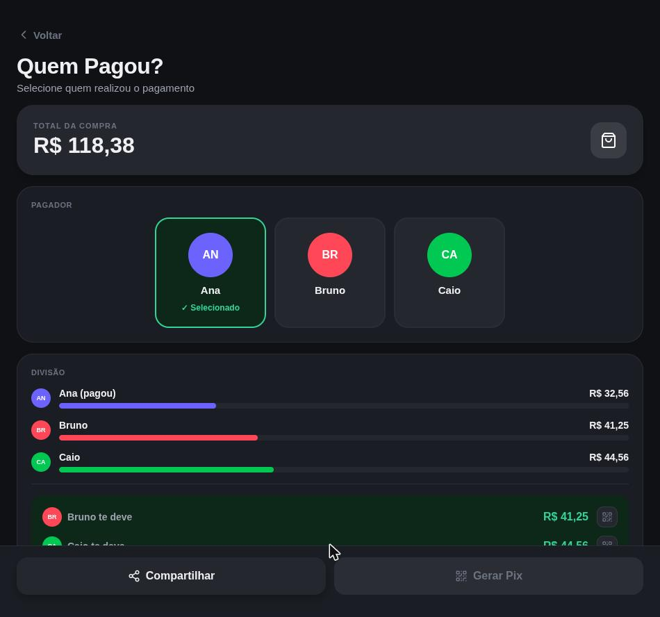 | 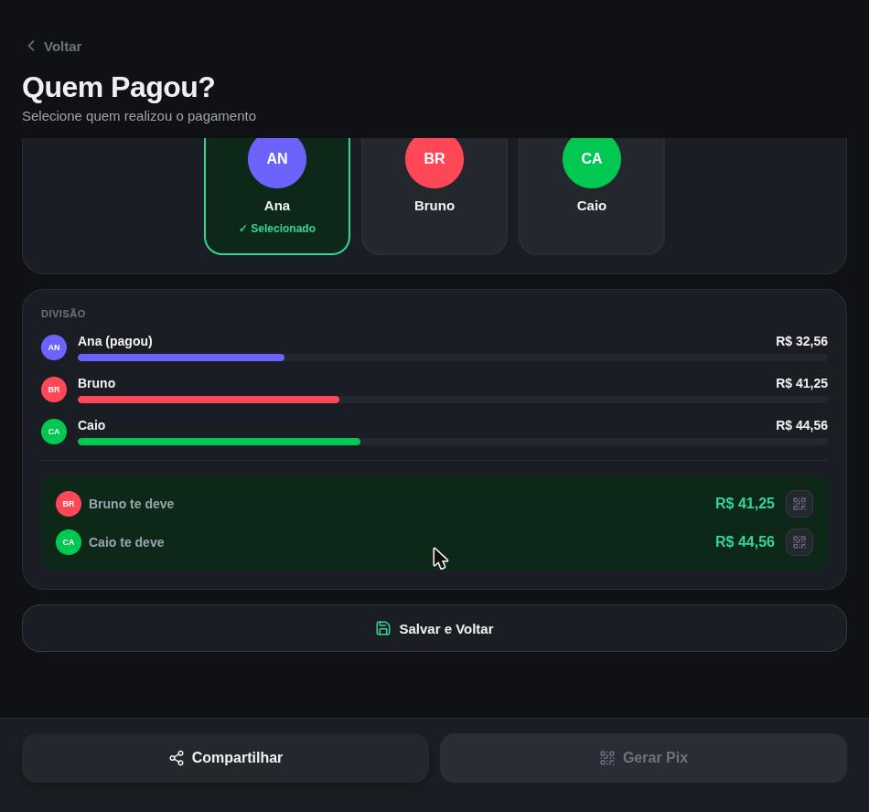 |
| --- | --- |
| *Figura 7 — Total e escolha do pagador.* | *Figura 8 — Parcelas e valores devidos ao pagador.* |

### 3.5. Histórico e reabertura (T6)

A divisão salva aparece na aba **Histórico**, com o mercado, o total, o pagador, os valores devidos e as datas da nota e do registro. Os **Detalhes da Compra** mostram cada item, quem participou e o valor correspondente. Esses dados podem ser filtrados por pessoa ou por uso coletivo. A divisão pode ser refeita sem importar a nota novamente.

A aba **Balanço** consolida os débitos entre os perfis e permite registrar quitações. Registrar uma quitação não processa nem confirma um pagamento bancário.

| 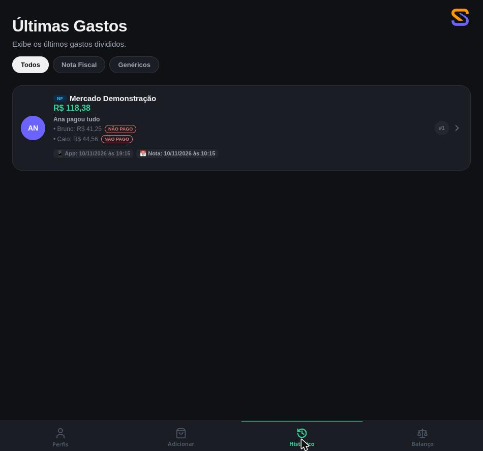 | 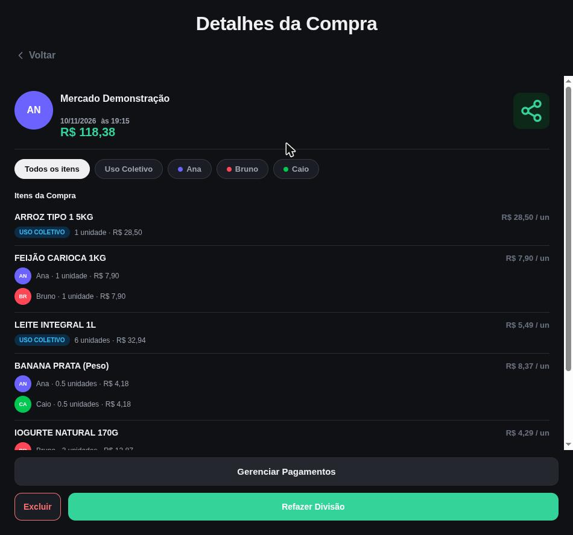 |
| --- | --- |
| *Figura 9 — Histórico de divisões.* | *Figura 10 — Detalhes da compra por item.* |

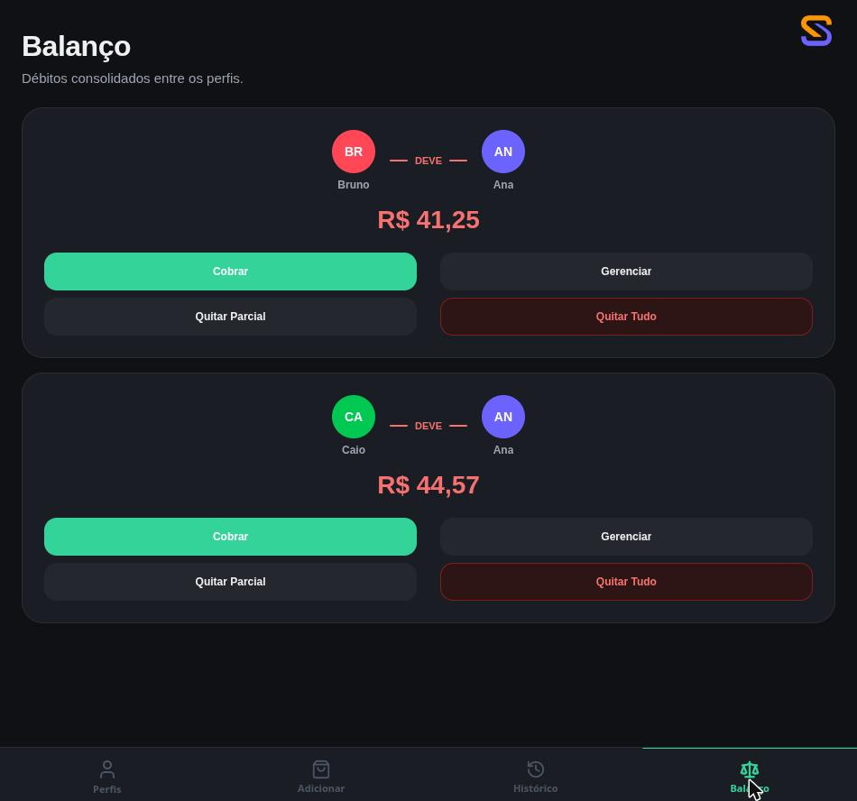

*Figura 11 — Balanço consolidado entre os perfis.*

### 3.6. Diferenças em relação ao fluxo planejado

| Fluxo da Entrega 3 | Comportamento implementado |
| --- | --- |
| Cadastrar ou selecionar os participantes de cada compra | Os perfis são cadastrados uma vez e todos participam de cada compra; "Todos" divide entre todos os perfis cadastrados. Subconjuntos são definidos item a item pelo Modo Personalizado. |
| Importar e conferir os produtos e o total | Não há tela com a lista completa antes da atribuição. A conferência acontece item a item, com o total no topo da tela. |
| Conferir pendências antes do resumo | O progresso e o bloqueio do botão **Finalizar** impedem itens pendentes. |
| Divisão de produtos por peso | O produto por peso é tratado como uma unidade, dividida em partes iguais pelo Modo Personalizado. |
| Desconto global proporcional (Cenário C) | O desconto é distribuído manualmente entre os itens; não há rateio proporcional automático. |
| Salvar e reabrir no histórico | Implementado, com limite de 15 compras no histórico de notas. |

## 4. Procedimento e participantes

As sessões ocorreram entre 04 e 07/11/2026, conforme o protocolo da Entrega 3.

- **Participantes:** cinco organizadores (V01 a V05), presencialmente, e três receptores do resumo (V06 a V08), por chamada. V09 desistiu antes da sessão e V10 não respondeu após dois contatos.
- **Condução:** Felipe e João Carlos alternaram os papéis de facilitador e observador.
- **Comparação:** cada organizador fez a divisão com o método atual e com o MVP, em ordem alternada e com notas diferentes. Os tempos do método atual foram cronometrados com limite de 12 minutos.
- **Tempos no MVP:** foram revisados em 10/11 com valores aproximados informados pela equipe (V01: 2,5 min; V02, V04 e V05: cerca de 3 min; V03: cerca de 5 min). Esses valores não constituem uma nova cronometragem, e por isso a redução de tempo é apresentada como **estimativa**.
- **Diversidade:** três organizadores não participaram da Entrega 2 e um (V02) já usava aplicativo de divisão (Splitwise). A planilha registra cinco residências distintas entre os recrutados.

| Código | Método atual | Atual (min) | MVP estimado (min) | T1–T6 sem ajuda | Ajuda | Erros | Redução estimada |
| --- | --- | --- | --- | --- | --- | --- | --- |
| V01 | Calculadora do celular | 10,5 | ~2,5 | Sim | 0 | 1 | 76,2% |
| V02 | Splitwise | 9,0 | ~3,0 | Não (ajuda em T4) | 1 | 2 | 66,7% |
| V03 | Calculadora + WhatsApp | Estourou 12 min | ~5,0 | Sim | 0 | 0 | Não comparável |
| V04 | Calculadora do celular | 8,0 | ~3,0 | Sim | 0 | 1 | 62,5% |
| V05 | Calculadora do celular | 11,0 | ~3,0 | Sim | 0 | 1 | 72,7% |

## 5. Resultados frente às metas da Entrega 3

| Indicador | Resultado | Meta (Entrega 3, seção 3.6) | Situação |
| --- | --- | --- | --- |
| Conclusão do fluxo T1–T6 sem ajuda | 4/5 = 80,0% | Pelo menos 80% (4 de 5) | Atingida |
| Conclusão por tarefa | T1, T2, T3, T5 e T6: 5/5; T4: 4/5 | Pelo menos 80% | Atingida |
| Redução mediana de tempo | 69,7% (4 pares, estimativa) | Pelo menos 25% | Estimativa acima da meta |
| Parcelas e reembolsos iguais ao gabarito | 5/5 sessões | 100% dos casos concluídos | Atingida nos registros (ver seção 7.2) |
| Facilidade média (1 a 7) | 5,93 | Pelo menos 5,5 | Atingida |
| MVP menos trabalhoso | 4/5 = 80,0% | Pelo menos 80% | Atingida |
| Preferência pelo MVP | 4/5 = 80,0% | Pelo menos 60% | Atingida |
| Clareza para receptores (V1) | 3/3 = 100% | Pelo menos 80% (3 de 3) | Atingida |
| Notas completas e corretas (H5) | 11/12 = 91,7% | Pelo menos 80% | Atingida |
| Linhas importadas corretamente (H5) | 247/259 = 95,4% | Pelo menos 90% | Atingida |
| Falhas silenciosas | Não aferido | Nenhuma | Verificação pendente |

**Facilidade por tarefa (média dos cinco organizadores):**

| T1 | T2 | T3 | T4 | T5 | T6 |
| --- | --- | --- | --- | --- | --- |
| 5,8 | 5,8 | 5,8 | 5,6 | 6,6 | 6,0 |

T4 (dividir entre todos e entre um subconjunto e ajustar uma atribuição) teve a menor facilidade média e concentrou o único pedido de ajuda (V02). T5 (pagador e resumo) foi a tarefa mais bem avaliada.

**Ajuda e erros:** um pedido de ajuda, nenhuma intervenção do facilitador e cinco erros anotados nos cinco organizadores.

**Receptores (V06 a V08):** os três explicaram a própria parcela, identificaram os itens e souberam a quem pagar, sem ajuda. A facilidade de entendimento foi 6, 7 e 5 (média 6,0). Os três usaram o resumo do Cenário B.

**Uso futuro e preço (H6 e H8, sem meta):**

- Três organizadores disseram que usariam o MVP na próxima compra (V01, V03 e V05) e dois responderam "talvez" (V02 e V04).
- Três pagariam pessoalmente e dois atribuíram o pagamento ao grupo.
- Medianas das faixas de preço por mês: R$ 2 (barato demais), R$ 4 (barato), R$ 8 (caro, mas aceitável) e R$ 12 (caro demais).
- V04 só usaria gratuitamente.

Essas respostas são exploratórias e não validam preço nem disposição efetiva de pagamento. O acompanhamento de reutilização em 14 dias está previsto para 18 a 20/11/2026.

## 6. Importação das notas (H5)

Foram feitas 12 tentativas de importação em quatro estabelecimentos de Lavras: Rex do Centro, Rex do Shopping, Mercado BH e Villefort. As notas incluíam produtos com mais de 20 itens, venda por peso, desconto e quantidade maior que um.

| Nota | Estabelecimento | Características | Esperadas | Corretas | Completa |
| --- | --- | --- | --- | --- | --- |
| N01 | Rex do Centro | quantidades > 1 | 18 | 18 | Sim |
| N02 | Mercado BH | desconto | 24 | 24 | Sim |
| N03 | Mercado BH | mais de 20 itens, peso | 31 | 31 | Sim |
| N04 | Rex do Centro | simples | 14 | 14 | Sim |
| N05 | Villefort | mais de 20 itens, peso | 22 | 22 | Sim |
| N06 | Villefort | desconto, quantidades > 1 | 27 | 27 | Sim |
| N07 | Villefort | simples | 16 | 16 | Sim |
| N08 | Villefort | desconto | 20 | 20 | Sim |
| N09 | Rex do Centro | simples | 12 | 0 | Não — portal da SEFAZ indisponível |
| N10 | Mercado BH | mais de 20 itens | 35 | 35 | Sim |
| N11 | Villefort | desconto | 19 | 19 | Sim |
| N12 | Rex do Shopping | mais de 20 itens, peso | 21 | 21 | Sim |
| **Total** | | | **259** | **247** | **11/12** |

A tentativa N09 permanece no denominador. A falha de acesso ao portal não foi excluída do cálculo da taxa de sucesso.

Na revisão de 10/11, N03, N10 e N11 passaram a constar como adequadas, conforme esclarecimento da equipe. N11 passou a ter 19 linhas corretas. A seção 3.6 da Entrega 3 determina que os resultados não sejam reclassificados retroativamente. Por isso, a evidência que motivou esse esclarecimento deve permanecer registrada junto à planilha.

## 7. Problemas e dificuldades

### 7.1. Observados nas sessões

| Problema | Origem | Encaminhamento |
| --- | --- | --- |
| Dificuldade para localizar o total na conferência | V01 procurou o total por cerca de 15 s (T2) | Destacar o total da nota e a comparação com a soma dos itens. |
| Botão de salvar pouco visível | V05 levou cerca de 25 s para encontrá-lo (T6) | Aumentar a visibilidade de **Salvar e Voltar**. |
| Portal da SEFAZ lento ou indisponível | V04 precisou repetir a leitura (T1); N09 não foi importada | Exibir aviso de demora e orientar uma nova tentativa. |
| Divisão entre subconjunto e ajuste (T4) | Único pedido de ajuda (V02) e menor facilidade média (5,6) | Explicar melhor o Modo Personalizado e a correção de atribuições. |
| Interface considerada pouco amigável | Sugestão de V02 | Revisar a hierarquia visual nas próximas iterações. |
| Compartilhamento do resumo com os demais moradores | Sugestões de V03 e V05 | O compartilhamento em texto existe e deve ser apresentado no fluxo. |

### 7.2. Identificados na revisão do aplicativo

Estes pontos foram encontrados pela equipe ao revisar o código e preparar as capturas em 10/11/2026. Eles **não foram registrados nas sessões** e não alteram os resultados da seção 5, mas afetam critérios do protocolo.

1. **Arredondamento de centavos sem regra definida.** Na demonstração, as parcelas exibidas no resumo foram R$ 32,56, R$ 41,25 e R$ 44,56, que somam R$ 118,37 para uma compra de R$ 118,38. A aba **Balanço** mostrou R$ 44,57 para o mesmo valor que o resumo e o histórico exibem como R$ 44,56. Nos detalhes da compra, a banana de R$ 8,37 aparece como R$ 4,18 + R$ 4,18. A seção 3.6 da Entrega 3 exige uma regra documentada de centavos e a soma exata com o total. Portanto, o critério de correção monetária não pode ser considerado aprovado em todos os casos até essa correção.
2. **Falhas silenciosas ainda não verificadas.** A planilha original continha uma fórmula inválida para esse indicador, e ele permanece "Não aferido". Os casos de conexão indisponível, QR inválido, nota incompatível e divergência precisam ser testados especificamente.
3. **Produtos por peso.** Esses produtos são tratados como uma unidade e só podem ser divididos em partes iguais. Não é possível atribuir pesos diferentes a cada pessoa.
4. **Desconto global.** O desconto precisa ser distribuído manualmente entre os itens. Não há opção de rateio proporcional, como no Cenário C do gabarito.
5. **Mudança de layout durante a atribuição.** Quando resta apenas uma unidade, o seletor de unidades desaparece e os botões dos perfis sobem. Na preparação das capturas, isso fez um toque cair em **Todos** em vez do perfil pretendido. O erro pode ser corrigido com **Desfazer**, mas o deslocamento favorece toques errados.
6. **Detalhes de apresentação.** Frações aparecem com ponto ("0.5 unidades"). O histórico de notas guarda somente as 15 compras mais recentes.

### 7.3. Registros a conferir

- O comentário de V03 menciona uma nota de 31 itens no método atual, mas a nota usada nessa condição (N05) tem 22 linhas esperadas.
- Os horários de V01 (14:10) e V02 (14:35) estão separados por 25 minutos, intervalo curto para uma sessão completa com os dois métodos e as perguntas.

## 8. Aprendizados

- **A importação pela nota é o principal valor percebido.** Os comentários destacaram não precisar digitar os produtos, o botão "Todos" e a origem conferível de cada valor. Mesmo o participante que preferiu o Splitwise (V02) reconheceu o detalhamento por item.
- **A atribuição item a item funciona, mas a divisão parcial exige mais explicação.** T4 concentrou a ajuda e a menor facilidade.
- **A dependência do portal da SEFAZ é o maior risco técnico.** A única nota sem importação e o único erro técnico observado nas sessões vieram da indisponibilidade ou lentidão do portal.
- **Fechar o total não basta: a regra de centavos precisa ser explícita e única em todas as telas.** A conferência das parcelas contra o gabarito precisa incluir casos com dízimas, como divisões por três e itens por peso.
- **O registro precisa ser feito durante a sessão.** A substituição dos tempos cronometrados por valores aproximados enfraqueceu a evidência de tempo. A revisão posterior das notas exigiu justificativa adicional. Cronometrar e registrar no momento da sessão evita esse tipo de reconstrução.
- **Valor percebido não implica pagamento.** As faixas de preço são baixas e um organizador só usaria gratuitamente, o que mantém o modelo freemium em investigação.

## 9. Modificações realizadas e planejadas

### 9.1. Realizadas

| Data | Modificação | Responsável |
| --- | --- | --- |
| 10/11/2026 | Planilha: fórmulas recalculando o resumo a partir das linhas registradas; indicador de falhas silenciosas marcado como "Não aferido" no lugar da fórmula inválida; identificação da equipe nas abas de sessão. | Tobias |
| 10/11/2026 | PDF de gabaritos refeito com a base V01 a V08 e as metas da Entrega 3, substituindo as tabelas U01 a U06 da versão anterior. | Tobias |
| 10/11/2026 | Documentação do fluxo real, capturas do aplicativo e consolidação da entrega. | João Gabriel |

Não há registro de alteração no código do aplicativo após as sessões. Os últimos commits em `src/` são de 05/11/2026, dentro do período de testes. Se alguma correção foi aplicada entre sessões, ela deve ser acrescentada a esta tabela com data e sessões afetadas.

### 9.2. Planejadas

| Prioridade | Modificação | Motivo |
| --- | --- | --- |
| Alta | Regra única de arredondamento, distribuindo o centavo restante de forma determinística e aplicada no resumo, histórico, balanço e compartilhamento | Seção 7.2, item 1; critério de correção monetária |
| Alta | Teste específico de falhas silenciosas (portal indisponível, QR inválido, nota incompatível e divergência de total) | Indicador não aferido |
| Alta | Aviso de demora e nova tentativa na consulta ao portal | V04 e N09 |
| Média | Destaque do total da nota e comparação com a soma dos itens antes da atribuição | V01 |
| Média | Botão de salvar mais visível no resumo | V05 |
| Média | Layout estável na atribuição, sem deslocar os perfis quando o seletor de unidades some | Seção 7.2, item 5 |
| Média | Orientação no Modo Personalizado para divisão entre parte do grupo | T4 e V02 |
| Baixa | Rateio proporcional automático do desconto global | Cenário C |
| Baixa | Divisão de produtos por peso em partes diferentes | Seção 7.2, item 3 |

Os casos afetados pela correção do arredondamento devem ser repetidos contra os gabaritos antes de considerar a correção monetária aprovada, conforme a seção 3.8 da Entrega 3.

## 10. Decisão e próximos passos

**Decisão proposta:** prosseguir e refinar o MVP. A conclusão do fluxo, a clareza, a preferência, a facilidade e a importação atingiram as metas nesta amostra.

Antes de declarar o MVP aprovado, a equipe deve:

1. corrigir a regra de centavos e repetir os casos de cálculo afetados;
2. testar e registrar o tratamento de falhas (falhas silenciosas);
3. realizar o acompanhamento de reutilização em 14 dias (18 a 20/11/2026);
4. preferencialmente, cronometrar novamente o tempo no MVP em novas sessões, para substituir a estimativa.

## 11. Limitações

- **Amostra:** pequena e de conveniência (cinco organizadores e três receptores). Os resultados descrevem esta rodada e não comprovam adoção de mercado.
- **Tempo:** os tempos no MVP são aproximações informadas pela equipe, não medições. A redução de tempo é uma estimativa.
- **Reclassificação das notas:** N03, N10 e N11 foram reclassificadas posteriormente, com base em esclarecimento da equipe.
- **Receptores:** os três receptores avaliaram o mesmo cenário (B).
- **Capturas:** foram geradas na versão web com dados de demonstração, não em sessões reais. A leitura do QR Code não foi capturada.
- **Reutilização:** a reutilização e a disposição de pagamento ainda não foram observadas.

## 12. Uso de Inteligência Artificial

O Claude (Anthropic) foi utilizado apenas como apoio na documentação, auxiliando na organização e redação deste texto. O conteúdo foi revisado pela equipe.
